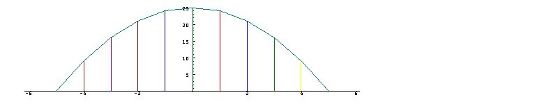
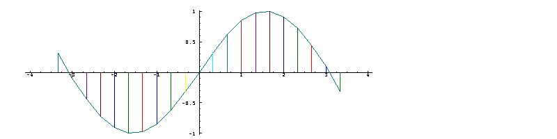
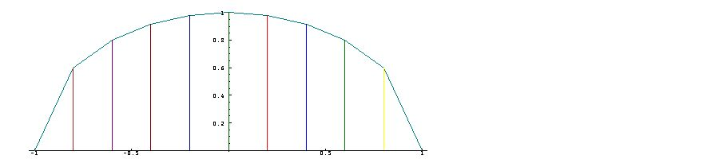

[3A. Plotting](#3a)

[3B. Local behaviour and area](#3b)

[3C. Graphs versus function tables](#3c)

[3D. Notes](#3d)

<span id="3a"></span>

## [3A. Plotting](#3-graphs-and-visualization) [S3A.](supplement.html#s3a)

A table of the function “twenty-five minus the square”, or “twenty-five with minus on the square” for each item of the argument `x=: i:5` can be prepared as follows:

```
   f=: 25 with - on *:
   x=: i:5
   x,:f x
_5 _4 _3 _2 _1  0  1  2  3 4 5
 0  9 16 21 24 25 24 21 16 9 0
```

Study of such a function table can reveal much about the behaviour of the function: for example, from `0` at the argument `_5`, it grows at an ever-decreasing rate to a high point at `0 25`, and then declines at an ever-increasing rate to `5 0`.

However, the characteristics of the function can be seen more easily in a graph of the function, produced by plotting each column of the table as follows: starting at an arbitrary point on a sheet of squared paper measure a distance `x` to the right (or left, if negative), and a distance `f x` upward (or downward, if negative), and mark the resulting point. Then join adjacent points by "lines", and points to arguments by "sticks".

Graphs can be produced quickly and accurately by the computer as follows:

```
   load 'plot'
   PLOT=: 'line,stick' with plot
   PLOT x;f x
```

 A plot can be removed from the screen (to permit further computation) by pressing the key labelled Esc. However, anyone unfamiliar with such graphs should perhaps make a few by hand, using simple functions such as the cube (`f=: ^ with 3`), negation (`f=: -`), and the identity (`f=: ]`).

Plots of polynomial functions may show further interesting characteristics. For example, study the plot of the following function, use `x,:fs x` or `x,.fs x` to make its table, and compare your observations with the remarks given below:

```
   fs=: 0 1 0 _1r6 0 1r120 0 _1r5040 with p.
   x=: 1r3*i:10
   PLOT x;fs x
```



**Remarks:** `fs` appears to be an oscillating function that begins at about `(-3+1r7),0`; drops at a decreasing rate to a low of `_1`; rises through `0 0` to a high of `1`; and again drops to about `(3+1r7),0`.

The result of `PLOT x;f x` is said to be a plot of `f x` “against” or “versus” the argument `x`. A function can also be plotted against another function, as illustrated in the following exercise.

**Exercises**

Execute the following sentences, and comment on the results:

```
   fc=: 1 0 _1r2 0 1r24 0 _1r720 0 1r40320 with p.
   set 5
   x,.fc x
   
   PLOT x;fc x
   
   (fc x),.(fs x)
   
   PLOT (fc x);(fs x)
```

To anyone familiar with the functions sine and cosine of trigonometry, it may be evident that the functions `fs` and `fc` are approximations of them.

Moreover, the cosine and sine of a given angle are sometimes defined as the coordinates of a point on the unit circle of radius 1, located at the given angle (that is, the arc length along the circumference). It should therefore come as no surprise that the plot of `fs` against `fc` in the preceding exercise produced an approximate circle.

The expression `d,:e` produces a two-rowed table from the lists `d` and `e`, and expressions of the form `c,d,:e` form multi-rowed tables from further lists. Moreover, `PLOT x;c,d,:e` plots each of the lists against `x` in a single graph, providing visual comparison of the functions represented by the lists.

**Exercises**

` PLOT x;(fs x),:fc x)`

` PLOT x;(fs x),:fc x-3r2)`

<span id="3b"></span>

## [3B. Local behaviour and area](#3-graphs-and-visualization) [S3B.](supplement.html#s3b)

In addition to providing an overall view of a function, its graph shows the local behaviour, the slopes of the individual segments reflecting its local rates of growth and decay.

Moreover, the graph provides a direct view of the area under it, a result of considerable significance.

This will be illustrated by a plot of a semi-circle. The function `cir=: 0 with o.` gives the square root of one minus the square of its argument. Its plot for the argument `a=: 1r5*i:5` is therefore a rough approximation to a semi-circle with a radius of one unit. Thus:

```
   cir=: 0 with o.
   a=: 1r5 * i:5
   a
_1 _4r5 _3r5 _2r5 _1r5 0 1r5 2r5 3r5 4r5 1
   PLOT a;cir a
```



The function `sum=: +/` sums a list, and `sum cir a` therefore sums the altitudes of the graph of the semi-circle, thus giving an approximation to its area (except that the sum must be multiplied by `1r5`, the common width of the trapezoids that form the area). Thus:

```
   sum=: +/
   1r5 * sum cir a
1.51852
   2*1r5 * sum cir a
3.03705
```

The last result is the approximate area of the complete circle, and is therefore an approximation to the constant `pi`. Better approximations are provided by a larger number of points:

```
   b=: 1r1000 * i:1000
   2 * +/1r1000 * cir b
3.14156
```

<span id="3c"></span>

## [3C. Graphs versus function tables](#3-graphs-and-visualization) [S3C.](supplement.html#s3c)

Insights provided by the graph of the function `cir` that are not provided so directly by its function table are based upon the pairwise views of adjacent points; the slopes of the line segments between them reflect the rate of change of the function, and the trapezoids defined by them provide a basis for the area.

Tables of functions that apply pairwise to their arguments can, however, provide similar insights. Moreover, they can provide other information (such as the rate of change of the rate of change) not readily grasped from a graph. To this end we will define a pairwise operator `pw`, a sum function, a commuted difference function, and an average or mean function. Thus:

```
   pw=: 1 : '2 with (u.\)'
   sum=: +/
   dif=: -~/
   mean=: sum % #
   y=:  cir a
   y
0 0.6 0.8 0.917 0.98 1 0.98 0.917 0.8 0.6 0
   mean y
0.69
   mean pw y NB. Average heights of the trapezoids
0.3 0.7 0.86 0.95 0.99 0.99 0.95 0.86 0.7 0.3
   dif pw y
0.6 0.2 0.12 0.063 0.02 _0.02 _0.063 _0.12 _0.2 _0.6
```

We will further illustrate the pairwise operator on a function for the Fibonacci numbers, using a definition discussed under “generating functions” in \[2\]:

```
   fib=: (0 1 with p. % 1 _1 _1 with p.)t.
   x=:  1 2 3 4 5 6 7 8 9 10 11 12 13   
   fib x
1 1 2 3 5 8 13 21 34 55 89 144 233

   sum pw fib x
2 3 5 8 13 21 34 55 89 144 233 377

   sum pw sum pw fib x
5 8 13 21 34 55 89 144 233 377 610

   dif pw fib x
0 1 1 2 3 5 8 13 21 34 55 89

   gm=: %/pw fib x  NB. Pairwise ratios
   set 4
   gm NB. Appproximations to golden mean
1 0.5 0.6667 0.6 0.625 0.6154 0.619 0.6176 0.6182 0.618 0.6181 0.618
   gm * 1 + gm
2 0.75 1.111 0.96 1.016 0.9941 1.002 0.9991 1 0.9999 1 1
```

Pairwise relations such as `dif pw f x` are easily seen in a graph of `f`, but repeated use (as in `dif pw dif pw f x`) are not. They can, however, provide interesting results when applied to familiar functions. For example:

```
   sqr=: ^ with 2
   sqr x
1 4 9 16 25 36 49 64 81 100 121 144 169
   dif pw sqr x
3 5 7 9 11 13 15 17 19 21 23 25
   dif pw dif pw sqr x
2 2 2 2 2 2 2 2 2 2 2
   dif pw dif pw dif pw sqr x
0 0 0 0 0 0 0 0 0 0

   dp=: dif pw
   dp sqr x
3 5 7 9 11 13 15 17 19 21 23 25
   dp dp sqr x
2 2 2 2 2 2 2 2 2 2 2

   cube=: ^ with 3
   cube x
1 8 27 64 125 216 343 512 729 1000 1331 1728 2197
   dp cube x
7 19 37 61 91 127 169 217 271 331 397 469
   dp dp cube x
12 18 24 30 36 42 48 54 60 66 72
   dp dp dp cube x
6 6 6 6 6 6 6 6 6 6
```

**Exercises**

Experiment with pairwise differences of other power functions, and of polynomials.

Experiment with the function `p2=: 2 with ^ ` and the use of the pair-wise quotients `%/ pw` and `%~/ pw` on it.

<span id="3d"></span>

## [3D. Notes](#3-graphs-and-visualization) [S3D.](supplement.html#s3d)

Chapters 2 and 3 introduced two important facilities for the study of functions, the function table, and graphs. Chapter 1 introduced one particularly important function, the polynomial -- important because it can approximate, and therefore be used to study, a wide range of functions. The next chapter examines it further.

Any reader puzzled by certain notations (such as the double use of `*` for both signum and multiplication in Section 1D) may wish to turn now to the two-page discussion of trains, inflections, ambivalence, and bonding in Section 10D.
