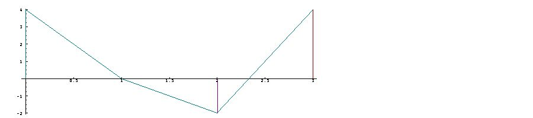
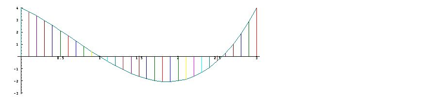
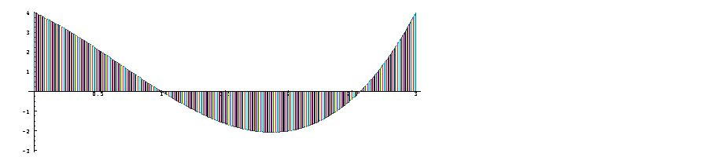
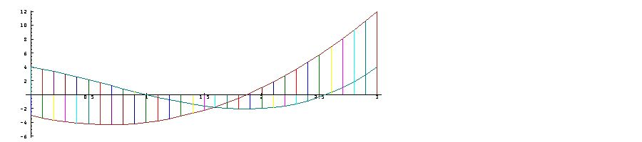

[6A. Approximation to the derivative (rate of change)](#6a)

[6B. Derivatives of polynomials](#6b)

[6C. Taylor coefficients](#6c)

[6D. Notes](#6d)

<span id="6a"></span>

## [6A. Approximation to the derivative (rate of change)](#6-slope-and-derivative) [S6A.](supplement.html#s6a)

As remarked in Section 3B, the slopes of the segments of a graph show the average rate of change of a function between adjacent points. Plotting more points at lesser intervals gives a better approximation. For example:

```
   c=: 4 _3 _2 1
   f=: c with p.
   x1=: i.4
   PLOT x1;f x1
```



```
 

   x2=: 1r10*i.31
   PLOT x2;f x2
```



```
 

   x3=: 1r100 * i.301
   PLOT x3;f x3
```



Considered as a sample of points on a continuous graph of the function (using an infinite number of points), these sloping lines are *secants* (cutting lines) to the continuous curve, and the slope at a point is the *tangent* (touching line) to the curve, which may be approximated by a secant with a small interval.

The expression `((f x+r)-(f x))%r `gives the slope of the graph of `f` between arguments `x` and `x+r` as the ratio of the rise `(f x+r)-(f x)` to the run `r`. For example:

```
   x=: 2
   r=: 1r10
   ((f x+r)-(f x)) % r
1.41
   x=: 0 1 2 3 4 5 6
   r=: 1r1000
   ((f x+r)-(f x)) % r
_3.002 _3.999 1.004 12.007 29.01 52.013 81.016

   r=: 1r10000
   ((f x+r)-(f x)) % r
_3.0002 _3.9999 1.0004 12.001 29.001 52.001 81.002
```

For these small values of the run, the slopes appear to be “approaching a limiting value” given approximately by the run of one ten-thousandth. This limiting value is the derivative of the function `f`, that is, the slope of the tangent. The value `r=: 0` might seem appropriate, but this only gives the meaningless division of a zero rise by a zero run. Thus:

```
   r=: 0
   ((f x+r)-(f x)) % r
0 0 0 0 0 0 0
```

The desired result is given by the derivative operator `d.`, with `f d.1` giving the (first) derivative of `f` and `f d.2` giving the second derivative (that is, the derivative of the derivative), and so on. For example:

```
   f d.1 x
_3 _4 1 12 29 52 81
   f d.2 x
_4 2 8 14 20 26 32
   f d.1 2 3 4 5 x
_3 _4 6 0 0
_4  2 6 0 0
 1  8 6 0 0
12 14 6 0 0
29 20 6 0 0
52 26 6 0 0
81 32 6 0 0
```

Moreover, the application of the Taylor operator to the resulting derivatives show them to be terminating power series, that is, ordinary polynomials:

```
   d=:  f d.1 t. i.7
   d
_3 _4 3 0 0 0 0
   f d.2 t. i.7
_4 6 0 0 0 0 0
   d with p. x
_3 _4 1 12 29 52 81
   d with p. d.1 x
_4 2 8 14 20 26 32
   f d.2 x
_4 2 8 14 20 26 32
```

The coefficients `d` of the first derivative polynomial must bear some relation to the coefficients `c` of the original polynomial `f`. We will explore this relation by examining their ratios, as seen in their divide table:

```
   d % table c
+--+----------------+
|  |   4  _3   _2  1|
+--+----------------+
|_3|_3r4   1  3r2 _3|
|_4|  _1 4r3    2 _4|
| 3| 3r4  _1 _3r2  3|
| 0|   0   0    0  0|
| 0|   0   0    0  0|
| 0|   0   0    0  0|
| 0|   0   0    0  0|
+--+----------------+
```

The diagonal of successive integers `1 2 3` suggests that `d` may be obtained from `c` by multiplying by successive integers, and rotating the result one place to the left:

```
   c
4 _3 _2 1
   #c NB. number of elements in c
4
   i.#c
0 1 2 3
   c * i.#c
0 _3 _4 3
   1 |. c * i.#c
_3 _4 3 0
   d
_3 _4 3 0 0 0 0
```

We will first test this relation on another polynomial function and then, in the following section, examine the question of why the relation holds in general:

```
   c2=: ! with 5 i.6
   c2
1 5 10 10 5 1
   f2=: c2 with p.
   d2=: f2 d.1 t. i.5
   d2
5 20 30 20 5
   1 |. c2 * i.#c2
5 20 30 20 5 0
```

<span id="6b"></span>

## [6B. Derivatives of polynomials](#6-slope-and-derivative) [S6B.](supplement.html#s6b)

The polynomial `f=: 4 1 3 2 with p.` is a sum of four monomials. Thus:

```
   f=: 4 1 3 2  with p.
   f0=: 4 with * on (^ with 0)
   f1=: 1 with * on (^ with 1)
   f2=: 3 with * on (^ with 2)
   f3=: 2 with * on (^ with 3)
   (f0,f1,f2,:f3) x
4 4  4  4   4   4   4
0 1  2  3   4   5   6
0 3 12 27  48  75 108
0 2 16 54 128 250 432
   (f0+f1+f2+f3) x
4 10 30 76 160 294 490
   f x
4 10 30 76 160 294 490
```

Any slope of a function that is a sum of functions equals the sum of the corresponding slopes of the component functions, and the derivative of a sum of functions is therefore the sum of the derivatives of the corresponding functions. For example:

```
   (f0 d.1 , f1 d.1 , f2 d.1 ,: f3 d.1) x
0 0  0  0  0   0   0
1 1  1  1  1   1   1
0 6 12 18 24  30  36
0 6 24 54 96 150 216

   (f0 d.1 + f1 d.1 + f2 d.1 + f3 d.1) x
1 13 37 73 121 181 253
   f d.1 x
1 13 37 73 121 181 253
```

Similar remarks apply to the multiplication that occurs in the monomials. For example, in `f2=: 3 with * on (^ with 2)`, the multiplication by three of the square function (`^ with 2`) multiplies each of its slopes by three, and therefore multiplies its derivative by three. It remains to determine the derivative of power functions such as the square. If `f=: ^ with 2`, then the rise `(f x+r)-(f x)` is given by the square of `x+r` (that is, `(x+r)*(x+r)`) minus the square of `x`.

Multiplication of the sums gives the square of `x` plus `2*x*r` plus the square of `r`, and subtraction of the square of `x` then leaves a rise of `2*x*r` plus the square of `r`. The slope of the square function (for the run `r`) is then given by dividing this sum by `r` to obtain `(2*x)+r`. The derivative is then given by the case for `r=: 0`, that is, `2*x` (or, equivalently, `2*x^1)`.

Similar calculations for the product `(x+r)*(x+r)*(x+r)`gives `3*x^2` for the derivative of the cube `^ with 3`, and, in general, gives `n*x^(n-1)`for the derivative of `^ with n`. The contribution of a monomial `cn * x ^ n` to the derivative polynomial is therefore the monomial `n * cn * x ^ (n-1)`, which therefore appears as a coefficient `n * cn` displaced one place to the left in the list of coefficients.

This is all embodied in the calculation `d=: 1: |. c * i.#c` given in the preceding section for the coefficients `d` of the derivative polynomial. These results will be summarized by defining a function `der` which, applied to a list of coefficients of a polynomial, gives the list of coefficients of the derivative polynomial. We will illustrate its use on the polynomial graphed in Section A, and will graph it together with the secant slopes of the function so that they can be compared:

```
   der=: 1: |. ] * i. on #
   c=: 4 _3 _2 1
   d=: der c
   d
_3 _4 3 0
   x2=: 1r10*i.31
   PLOT x2 ; (c with p. ,: d with p.) x2
```



Note that the zero value of the graph of the derivative occurs at the argument value for which the original function reaches its low point, that is, where its graph is horizontal.

The phrase *derivative of `f`* correctly suggests that it is a function derived from `f`, but it is only one among many (such as the inverse) also derived from `f`. The phrase *slope of `f`* would be more informative, and could be distinguished from the associated *secant slope of `f`*. <span id="6c"></span>

## [6C. Taylor coefficients](#6-slope-and-derivative) [S6C.](supplement.html#s6c)

It is also interesting to compare the Taylor coefficients of the derivative of the polynomial `d with p.` with the result of the function `der`:

```
   d with p. d.1 t. i.8
_4 6 0 0 0 0 0 0
   der d
_4 6 0 0
```

As a foretaste of the growth and oscillating functions of the next two chapters, we will also show Taylor series for the exponential and sine functions:

```
   exp=: ^
   exp t. i=:  i.10r1
1 1 1r2 1r6 1r24 1r120 1r720 1r5040 1r40320 1r362880

   exp d.1 t. i
1 1 1r2 1r6 1r24 1r120 1r720 1r5040 1r40320 1r362880
   exp d.2 t. i
1 1 1r2 1r6 1r24 1r120 1r720 1r5040 1r40320 1r362880

   sin=:  1 with o.
   ]s=: sin t. i.12r1
0 1 0 _1r6 0 1r120 0 _1r5040 0 1r362880 0 _1r39916800
   der s
1 0 _1r2 0 1r24 0 _1r720 0 1r40320 0 _1r3628800 0
   sin d.1 t. i.11r1
1 0 _1r2 0 1r24 0 _1r720 0 1r40320 0 _1r3628800
   der der s
0 _1 0 1r6 0 _1r120 0 1r5040 0 _1r362880 0 0
   der der der s
_1 0 1r2 0 _1r24 0 1r720 0 _1r40320 0 0 0
   der der der der s
0 1 0 _1r6 0 1r120 0 _1r5040 0 0 0 0
   s
0 1 0 _1r6 0 1r120 0 _1r5040 0 1r362880 0 _1r39916800
```

<span id="6d"></span>

## [6D. Notes](#6-slope-and-derivative) [S6D.](supplement.html#s6d)

For an arbitrary function `f` (such as any one of the functions of trigonometry), the matter of the limiting value of the secant slope `((f x+r)-(f x)) % r` as `r` “approaches” zero (discussed in Section 6A) raises difficult questions that are properly answered only by lengthy analysis of the notion of limits. This is what makes Calculus such a forbidding subject.

In this chapter we have skirted the issue by confining attention to polynomial functions, for which the limit of the secant slope is easily obtained. We will, however, extend these results to the many important functions that can be approximated by the power series (themselves polynomials) that were discussed in Chapter 5.

Can we be certain that the derivative of a polynomial approximation to a function `f` is a good approximation to the derivative of `f` ? Yes, but only for functions that are “uniformly continuous”. This is true of a wide range of functions of practical interest, including all of those to be treated in subsequent chapters.
