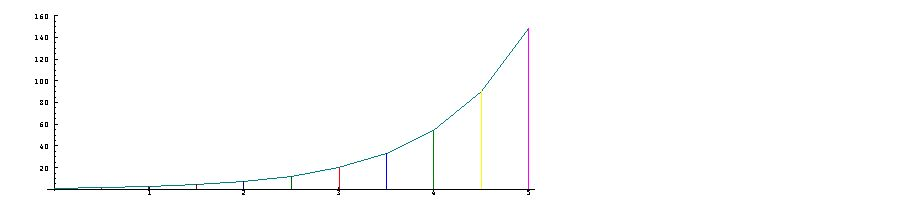

[7A. Growth polynomials](#7a)

[7B. The name "exponential"](#7b)

<span id="7a"></span>

## [7A. Growth polynomials](#7-growth-and-decay) [S7A.](supplement.html#s7a)

It is a common observation that growing things (such as young plants and animals, young commercial companies, and a colony of bacteria) change not at a constant rate, but at a rate roughly proportional to present size.

The simplest case is where the rate of growth is equal to the size -- this is described by the exponential function, denoted here by `^` . In a graph of this function this relation may be seen approximately in the slopes of the secants. Thus:

```
   x=: 1r2*i.11
   x
0 1r2 1 3r2 2 5r2 3 7r2 4 9r2 5
   set 4
   ^ x
1 1.649 2.718 4.482 7.389 12.18 20.09 33.12 54.6 90.02 148.4
   PLOT x;^x
```



Since a polynomial may be found that can approximate almost any function, it should be possible to find one that approximates the exponential. Consider the following:

```
   c=: 1 1 1r2 1r6 1r24 1r120 1r720 1r5040
   der=: 1:|.]*i.@:# NB. Gives coeffs of derivative 
   d=: der c
   d
1 1 1r2 1r6 1r24 1r120 1r720 0

   dec c with p. x
1 1.649 2.718 4.481 7.381 12.13 19.85 32.23 51.81 82.22 128.6
   dec d with p. x
1 1.649 2.718 4.478 7.356 12.01 19.41 30.95 48.56 74.81 113.1
```

The two polynomials differ only in the term `1r5040*x^7`, and are therefore nearly equal for reasonably small values of `x`. Moreover, the pattern required of further coefficients is clear: coefficient `k` must be `1%!k`. Thus:

```
   ! i. 12r1
1 1 2 6 24 120 720 5040 40320 362880 3628800 39916800
   a=: 1 % ! i. 12
   b=: der a
   (a with p. ,. b with p. ,. ^) x
    1     1     1
1.649 1.649 1.649
2.718 2.718 2.718
4.482 4.482 4.482
7.389 7.389 7.389
12.18 12.18 12.18
20.08 20.08 20.09
33.11 33.08 33.12
54.55 54.44  54.6
 89.8 89.42 90.02
147.6 146.4 148.4
```

**Exercises**

Experiment with expressions such as `^(x+3)` and `(^x) * (^3)`, and comment on the results.

Try the following expressions, and comment on the results:

```
   (^x) * (^-x)
   ^(x+-x)
   set 2
   ^-x
   % ^ x
   decay=: ^ on -
   decay x
   decay t. i. 10
```

<span id="7b"></span>

## [7B. The name Exponential](#7-growth-and-decay) [S7B.](supplement.html#s7b)

In the dyadic use of the symbol `^`, the expression `x^e` is said to denote the *base* `x` to the *exponent* `e`, and the function `x with ^` may therefore be said to be an *exponential* function. For example:

```
   e=: 1r10*i.11
   e
0 1r10 1r5 3r10 2r5 1r2 3r5 7r10 4r5 9r10 1
   3^e
1 1.1 1.2 1.4 1.6 1.7 1.9 2.2 2.4 2.7 3
   3 with ^ e
1 1.1 1.2 1.4 1.6 1.7 1.9 2.2 2.4 2.7 3
   ^e
1 1.1 1.2 1.3 1.5 1.6 1.8 2 2.2 2.5 2.7
   2 with ^ e
1 1.1 1.1 1.2 1.3 1.4 1.5 1.6 1.7 1.9 2
```

The exponential function `^` appears to lie between the functions `2 with ^` and `3 with ^`. Thus:

```
   set 7
   (^,.2.5 with ^,.2.75 with ^,.2.71 with 
^,.2.718 with ^,.1x1 with ^) e
       1        1        1        1        1        1
1.105171 1.095958 1.106454 1.104834 1.105159 1.105171
1.221403 1.201124  1.22424 1.220658 1.221377 1.221403
1.349859 1.316382 1.354565 1.348624 1.349817 1.349859
1.491825   1.4427 1.498763 1.490005 1.491763 1.491825
1.648721 1.581139 1.658312 1.646208 1.648636 1.648721
1.822119 1.732862 1.834846 1.818786 1.822005 1.822119
2.013753 1.899144 2.030172 2.009456 2.013607 2.013753
2.225541 2.081383 2.246292 2.220115 2.225356 2.225541
2.459603 2.281109 2.485418 2.452858 2.459374 2.459603
2.718282      2.5     2.75     2.71    2.718 2.718282
```

The base that gives the exponential exactly is called Euler’s number, and is denoted in math by *e* and in J by `1x1` .
