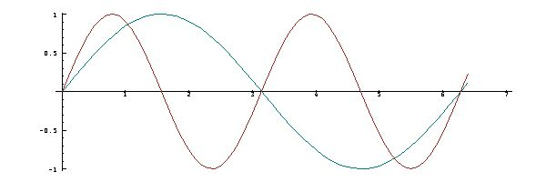

[8A. Introduction](#8a)

[8B. Harmonics](#8b)

[8C. Decay](#8c)

<span id="8a"></span>

## [8A. Introduction](#8-vibrations) [S8A.](supplement.html#s8a)

Vibrations are commonly seen in the motions of a clock pendulum, of a piano string, and of a weight (such as a plumb bob suspended on a rubber band or steel spring). If the bob is pulled straight down a certain distance from its rest position and released, it visibly oscillates above and below its rest position until it is brought to rest by friction in the air and in the suspension.

If `b` is a function that gives the position of the bob as a function of time, then its speed or velocity is given by `b d.1` (the rate of change of position), and its acceleration is given by the second derivative `b d.1 d.1` (the rate of change of its velocity).

Moreover, the acceleration is caused by the “restoring force” exerted by the spring, which is proportional to its extension as measured by the position `b` of the bob. In other words, the second derivative `b d.1` is proportional to `-b`.

In the simplest case `-b` is equal to `b d.1 d.1`, and we seek a polynomial with this property. Consider the coefficients of the function `fs` introduced in Section 3A:

```
   c=:  0 1 0 _1r6 0 1r120 0 _1r5040
   der c
1 0 _1r2 0 1r24 0 _1r720 0
   der der c
0 _1 0 1r6 0 _1r120 0 0
   -der der c
0 1 0 _1r6 0 1r120 0 0
```

The required pattern is clear: it is the same as for the exponential of Chapter 7, except that alternate coefficients are zero, and that the other coefficients alternate in sign. The function with this property is called the sine, commonly abbreviated to sin:

```
   sin=: 1 with o.
   sin t. i.12
0 1 0 _1r6 0 1r120 0 _1r5040 0 1r362880 0 
_1r39916800
   sin t. 20 21 22 23
0 1r51090942171709440000 0 _1r25852016738884976640000
```

<span id="8b"></span>

## [8B. Harmonics](#8-vibrations) [S8B.](supplement.html#s8b)

The function `sin on (2:*])` applies the sin to the double of its argument, and therefore produces a vibration (or *oscillation*) of twice the frequency. It is called an *harmonic* of the oscillation `sin`. This may be seen in a combined plot of the two functions:

```
  x=: 1r10 * i.65
  plot x;(sin x) ,: (sin on (2:*]) x)
```



**Exercises**

Replace the `2` in the function `sin on (2:*])` by other integers to produce other harmonics, and plot the results.

Plot the function `cos` and some of its harmonics.

Plot the function `cos` against its harmonic `cos on (2:*])`.

<span id="8c"></span>

## [8C. Decay](#8-vibrations) [S8C.](supplement.html#s8c)

Because of "friction" of some sort, vibrations commonly decay, usually at an approximately exponential rate determined by a function of the form `decay=: ^ on - on (] % [)`.

**Exercises**

Plot the decaying oscillation `sin * 6 with decay`.

Plot sine and cosine functions with rates of decay other than `6`, and plot them together with their non-decaying counterparts.
