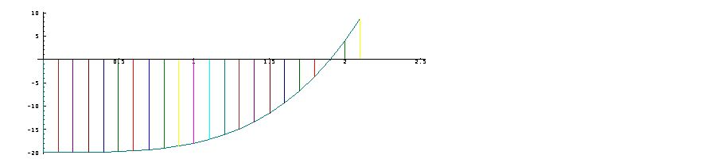
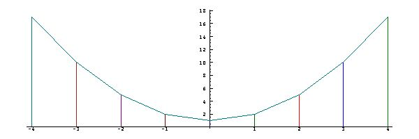

[9A. Inverse](#9a)

[9B. Equations](#9b)

[9C. The method of false position](#9c)

[9D. Newton’s method](#9d)

[9E. Roots of Polynomials](#9e)

[9F. Logarithms](#9f)

<span id="9a"></span>

## [9A. Inverse](#9-inverses-and-equations) [S9A.](supplement.html#s9a)

The predecessor function (`<:`) introduced in 1D is said to be the *inverse* of the successor function (`>:`) because it “undoes” its work. For example:

```
   >:1 2 3 4 5
2 3 4 5 6
   <:>:1 2 3 4 5
1 2 3 4 5
```

Conversely, `>:` is also the inverse of `<:`, and we may simply say that the two are inverses.

The need for inverse functions arises frequently. For example, the heat produced by an electric heater may be given by the function `h=: (* with 4) on sqr`, where `sqr=: *:` is the square function. In order to determine the voltage required to produce a desired heat, we need the inverse `v=: sqrt on (% with 4)`, where `sqrt=: %:` is the square root function. Thus:

```
   h=: (* with 4) on sqr
     sqr=: *:
   v=: sqrt on (% with 4)
     sqrt=: %:
   h 0 1 2 3 4 5 6 7
0 4 16 36 64 100 144 196 
   v h 0 1 2 3 4 5 6 7 
0 1 2 3 4 5 6 7 
   v 0 1 2 3 4 5 6 7 
0 0.5 0.707107 0.866025 1 1.11803 1.22474 1.32288 
   h v 0 1 2 3 4 5 6 7 
0 1 2 3 4 5 6 7
```

For many (but not all) functions, the inverse operator `INV=: ^:_1` produces the inverse function. For example:

```
   INV=: ^:_1
   <:INV 0 1 2 3 4 5 6 7
1 2 3 4 5 6 7 8
   cube=: ^ with 3
   cuberoot=: cube INV

   cube 0 1 2 3 4 5 6 7
0 1 8 27 64 125 216 343
   cuberoot cube 0 1 2 3 4 5 6 7
0 1 2 3 4 5 6 7

   ^ with 4 INV 0 1 2 3 4 5 6 7
0 1 1.18921 1.31607 1.41421 1.49535 1.56508 1.62658
   ^ with 4 ^ with 4 INV 0 1 2 3 4 5 6 7
0 1 2 3 4 5 6 7

   f=: ^ with 3 + ^ with 4
   f 0 1 2 3 4 5 6 7
0 2 24 108 320 750 1512 2744
   f INV 0 1 2 3 4 5 6 7
|domain error
|       f INV 0 1 2 3 4 5 6 7
```

<span id="9b"></span>

## [9B. Equations](#9-inverses-and-equations) [S9B.](supplement.html#s9b)

However, for a specific argument, say `y=: 20`, we could find the value of the inverse of `f` by guessing the result `x`, and applying `f` to it to guide us to an improved guess, by either increasing or decreasing `x`. For example:

```
   y=: 20
   x=: 2
   f x
24
   x=: x-1r2 
   set 5
   f x
8.4375
   x=: x+1r4
   dec f x
14.738
   dec f x=: x+1r8
18.951
   dec f x=: x+1r16
21.365
   dec f x=: x-1r32
20.131
   dec f x=: x-1r64
19.535
   dec f x=: x+1r128
19.831
   dec f x=: x+1r256
19.981
   dec f x=: x+1r512
20.056
   dec x
1.9043
```

This problem is commonly stated as the *equation* `(f x)=y`, implying that one is to find a value of `x` such that the relation is true. Moreover, the problem of solving equations is commonly introduced with little or no clue as to why the matter is important.

The function `g=: - with y on f` differs from `f` in subtracting `y` from the result, and a solution of `(g x)=0` is therefore a solution of `(f x)=y`. A solution of `(g x)=0` is said to be a *root* of the function `g`. <span id="9c"></span>

## [9C. The method of false position](#9-inverses-and-equations) [S9C.](supplement.html#s9c)

If one knows two values `a` and `b` such that `g a` and `g b` differ in sign, then a root of `g` must lie somewhere between them; the list `ab=: a,b` is said to bracket the root. Evaluation of `f` at its midpoint `m` (that is, `m=: mean ab`) will either yield zero (in which case `m` is a root of `g`), or it will differ in sign from one of the two results of `g ab`.

The element of `ab` that differs can be used with `m` to form a tighter bracket, whose mean will give a better approximation to the root of `g`. This process may be repeated to obtain as close an approximation as desired. For example:

```
   g=: - with y on f
   g ab=: 1,2
_18 4
   mean=: +/ % #
   ]m=: mean ab
1.5
   g m
_11.563
   ]ab=: m,1{ab
1.5 2
   g ab
_11.563 4
```

In general, a bracket of a root of a function `g` may be tightened by the function `tighten`, defined and illustrated below:

```
   tighten=:  mean,(sign on{. on g = sign on g on mean) { ]
   tighten ab=: 1,2
1.5 2
   tighten tighten tighten ab
1.875 2
   g tighten tighten tighten ab
_1.0486 4
```

The function `tighten` may be paraphrased as follows: Compare the sign of the first element (`{.`) of the result of `g` for equality with the sign of `g` on the mean, and use the result (`0` or `1`) as an index to select from the argument; finally, catenate the selection with the mean. The operator `^:` can be used to apply a function repeatedly, as illustrated below:

```
   tighten^:3 ab
1.875 2
   z=: tighten^:0 1 2 3 4 5 6 7 8 9 10 11 12 ab
   z;g z
+---------------+-------------------------+
|      1       2|         _18            4|
|    1.5       2|    _11.5625            4|
|   1.75       2|    _5.26172            4|
|  1.875       2|    _1.04858            4|
| 1.9375   1.875|     1.36501     _1.04858|
|1.90625   1.875|    0.131333     _1.04858|
|1.89063 1.90625|   _0.465246     0.131333|
|1.89844 1.90625|   _0.168624     0.131333|
|1.90234 1.90625|  _0.0190637     0.131333|
| 1.9043 1.90234|   0.0560301   _0.0190637|
|1.90332 1.90234|    0.018457   _0.0190637|
|1.90283 1.90332|_0.000309859     0.018457|
|1.90308 1.90283|  0.00907195 _0.000309859|
+---------------+-------------------------+
```

<span id="9d"></span>

## [9D. Newton’s method](#9-inverses-and-equations) [S9D.](supplement.html#s9d)

If `x=: 2` is an appoximation to the root of `g`, then (as suggested by the small “triangle” with apex at the point `x,g x` in the accompanying graph) a good correction is provided by dividing `g x` by the derivative `g d.1 x` that gives the slope of the tangent to the graph at the point `x,g x`:

```
    PLOT x;g x=: 1r10*i.22
```



```
   x=: 2
   (g , g d.1 , g%g d.1) x
4 44 0.0909091
   
   x=: x - (g%g d.1) x
   g x
0.24124
   x=: x - (g%g d.1) x
   g x
0.00106658
   
   newton=: ] - g % g d.1
   newton 2
1.90909
   g newton 2
0.24124
   
   newton^:(i.4) 2
2 1.90909 1.90287 1.90284
   g newton^:(i.4) 2
4 0.24124 0.00106658 2.1139e_8
   
   g newton ^:(i.3 5) 25
  406230     128520      40655     12855.8     4061.08
 1279.01    399.129    121.057     33.5929     7.07075
0.658183 0.00775433 1.11692e_6 2.13163e_14 3.55271e_15
```

Although Newton’s method converged rather rapidly for the function `g`, its convergence is not guaranteed in general, especially for initial guesses far from the root. <span id="9e"></span>

## [9E. Roots of Polynomials](#9-inverses-and-equations) [S9E.](supplement.html#s9e)

The (possibly multiple) roots of a polynomial `c with p.` may, in principle, be obtained by the methods of sections 9C and 9D, but it may be difficult to find suitable brackets or initial guesses. However, the function `roots=: > on {: on p.` may be applied to the coefficients `c` to obtain the roots. For example:

```
   roots=: > on {: on p.
   c=: _1 0 1
   r=: roots c
   r
1 _1
   c p. r
0 0
   
   d=: 6 1 _4 1
   s=: roots d
   s
3 2 _1
   d p. s
3.55271e_15 2.66454e_15 0
```

Because of the limited precision of the computations leading to the roots `s`, the application of the polynomial to them yields tiny results, but not exact zeros. The following function (the product of the sign function with the magnitude) serves to make such results more readable by "zeroing" tiny results:

```
   zero=: **|
   zero d p. s
0 0 0
```

A graph of the polynomial `1 0 1 with p.` (one plus the square) indicates that it has no roots, because the graph never drops to zero:

```
   e=: 1 0 1
   x=: i:4
   PLOT x;e p. x
```



Nevertheless, the function `roots` applies as follows:

```
   roots e
0j1 0j_1
   e p. roots e
0 0
```

The root `0j1` is an example of an *imaginary* number, to be discussed in Chapter 19. Its square is negative one:

```
   0j1*0j1
_1
```

<span id="9f"></span>

## [9F. Logarithms](#9-inverses-and-equations) [S9F.](supplement.html#s9f)

The *logarithm* (`^.`) is the function inverse to the exponential:

```
   ^ ^:_1
^.
   ^. ^:_1
^   
   ]x=: i.8
0 1 2 3 4 5 6 7
   ^x
1 2.71828 7.38906 20.0855 54.5982 148.413 403.429 1096.63
   ^.^x
0 1 2 3 4 5 6 7
   
   ^.x
__ 0 0.693147 1.09861 1.38629 1.60944 1.79176 1.94591
   ^^.x
0 1 2 3 4 5 6 7
```

As discussed in Section 7B, the exponential `^` is equal to `e with ^`, where `e=: 1x1` is Euler's number. Similarly, `e with ^.` is inverse to `e with ^`, as illustrated below:

```
   e=: 1x1
   e
2.71828
   e with ^ x
1 2.71828 7.38906 20.0855 54.5982 148.413 403.429 1096.63
   e with ^. e with ^ x
0 1 2 3 4 5 6 7
   
   10 with ^ x
1 10 100 1000 10000 100000 1e6 1e7
   10 with ^. 10 with ^ x
0 1 2 3 4 5 6 7
   
   10 with ^. 1 10 100 1000 10000 100000
0 1 2 3 4 5
```

The function `10 with ^.` is the *base*-10 *logarithm*, more commonly used in elementary math than the *natural log* `^.` .

The logarithm is discussed further in Chapter 20.
