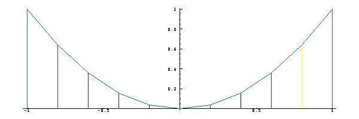
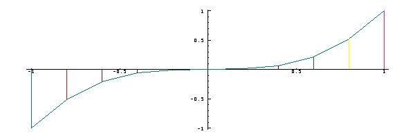
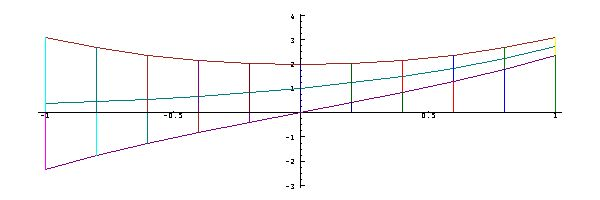
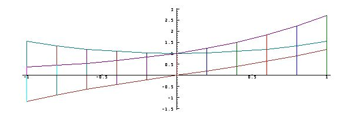

[14A. Introduction](#14a)

[14B. Commutativity](#14b)

[14C. Associativity](#14c)

[14D. Symmetry](#14d)

[14E. Distributivity](#14e)

[14F. Distributivity of dyadic functions](#14f)

[14G. Parity](#14g)

<span id="14a"></span>

## [14A. Introduction](#14-properties-of-functions) [S14A.](supplement.html#s14a)

A pair of expressions (such as `x*y` and `y*x`) that give identical results for all possible values of the arguments are said to form an identity. Identities are important because they allow a function to be expressed in different ways, each of which may possess particular advantages, such as ease of evaluation or insight into the behaviour of the function.

For example, Section 11C showed that `+/ odd n` (the sum of the first `n` odd numbers) is identical to the more easily computed product `n*n`. Similarly, the sum of the squares of the first `n` positive integers (`+/(1+i.n)^2`) is identical to the polynomial `0 1r6 1r2 1r3 p. n`.

Certain important identities are expressed as general properties of functions, referred to as *commutativity*, *associativity*, *symmetry*, *distributivity*, and *parity*. <span id="14b"></span>

## [14B. Commutativity](#14-properties-of-functions) [S14B.](supplement.html#s14b)

The commute operator `~` interchanges the arguments of the function to which it is applied. For example:

```
   3 -~ 5
2
   5 – 3
2
   from=: -~
   3 from 5
2
   into=: %~
   5 into 3
0.6
```

If `f~` is identical to `f`, then the function `f` is said to be commutative. For example, `+` and `*` are commutative, but `-` and `%` are not.

**Exercises**

Test a number of functions for commutativity, including `<`, `=`, `[`(left), `]`, `<.` (min), `>.`, `+:` (greatest common divisor), and `*:` (least common multiple).

Make function tables of the form `f table i:4` for both commutative and non-commutative functions, and observe the symmetry of the former.

<span id="14c"></span>

## [14C. Associativity](#14-properties-of-functions) [S14C.](supplement.html#s14c)

The expressions `3-(4-5)` and `(3-4)-5` apply the same function to the same arguments, but yield different results because the parentheses associate them differently; subtracting `5` from `4` and then subtracting the result from `3` to yield `4` in the first case, and subtracting `4` from `3` and then subtracting `5` from the result to yield `_6` in the last.

A function that yields the same result for any association imposed by parentheses is said to be associative. For example, `3+(4+5)` and `(3+4)+5` both yield `12`.

**Exercises**

Test a number of functions for associativity.

<span id="14d"></span>

## [14D. Symmetry](#14-properties-of-functions) [S14D.](supplement.html#s14d)

A function that applies to any permutation of a list to yield the same result is said to be symmetric. For example:

```
   +/2 3 5 7
17
   +/3 5 2 7
17
   -/2 3 5 7
_3
   -/3 5 2 7
_7
```

If `f` is both associative and commutative, then `f/` is symmetric. For example:

```
   all=: (i.!3) A. 2 3 5r1
   all
2 3 5
2 5 3
3 2 5
3 5 2
5 2 3
5 3 2

   lcm=: *.
   eachrow=: "1
   lcm/ eachrow all
30 30 30 30 30 30
   %/ eachrow all
10r3 6r5 15r2 6r5 15r2 10r3
```

<span id="14e"></span>

## [14E. Distributivity](#14-properties-of-functions) [S14E.](supplement.html#s14e)

If `f(x g y)` is equivalent to `(f x)g(f y)`, we say that the (monadic) function `f` distributes over the (dyadic) function `g`. The two parts of this identity may also be stated as `f on g` and `(f on [) g (f on ])`. For example, `+:` (double) and `-:` (halve) each distribute over both addition and subtraction, facts that may be tested in the following manner:

```
   3 (+:on+) 5
16
   3 (+:on[ + +:on]) 5
16
```

The operator `over` defined below can be used in the expression `f over g` to test whether `f` distributes over `g`. Thus:

```
   over=: 2 : '(u. on v.) = ((u. on [) v. (u. on ]))'each
   (+:over - table ,. -: over + table ,. +: over * table) i:3
+--+----------------+--+----------------+--+----------------+
|  |_3 _2 _1 0 1 2 3|  |_3 _2 _1 0 1 2 3|  |_3 _2 _1 0 1 2 3|
+--+----------------+--+----------------+--+----------------+
|_3| 1  1  1 1 1 1 1|_3| 1  1  1 1 1 1 1|_3| 0  0  0 1 0 0 0|
|_2| 1  1  1 1 1 1 1|_2| 1  1  1 1 1 1 1|_2| 0  0  0 1 0 0 0|
|_1| 1  1  1 1 1 1 1|_1| 1  1  1 1 1 1 1|_1| 0  0  0 1 0 0 0|
| 0| 1  1  1 1 1 1 1| 0| 1  1  1 1 1 1 1| 0| 1  1  1 1 1 1 1|
| 1| 1  1  1 1 1 1 1| 1| 1  1  1 1 1 1 1| 1| 0  0  0 1 0 0 0|
| 2| 1  1  1 1 1 1 1| 2| 1  1  1 1 1 1 1| 2| 0  0  0 1 0 0 0|
| 3| 1  1  1 1 1 1 1| 3| 1  1  1 1 1 1 1| 3| 0  0  0 1 0 0 0|
+--+----------------+--+----------------+--+----------------+
```

**Exercises**

Use `over` to test whether `+:` distributes over `gcd` and `lcm`.

Since double and halve each distribute over addition, and since they may be expressed as the equivalent functions `d=: * with 2` and `h=: % with 2` it appears that numbers other than `2` would do as well, that is, any multiple or fraction function would distribute over addition (and subtraction). Thus:

```
   (((* with 2.5)over + table),.((% with 4)over + table))i:3
+--+----------------+--+----------------+
|  |_3 _2 _1 0 1 2 3|  |_3 _2 _1 0 1 2 3|
+--+----------------+--+----------------+
|_3| 1  1  1 1 1 1 1|_3| 1  1  1 1 1 1 1|
|_2| 1  1  1 1 1 1 1|_2| 1  1  1 1 1 1 1|
|_1| 1  1  1 1 1 1 1|_1| 1  1  1 1 1 1 1|
| 0| 1  1  1 1 1 1 1| 0| 1  1  1 1 1 1 1|
| 1| 1  1  1 1 1 1 1| 1| 1  1  1 1 1 1 1|
| 2| 1  1  1 1 1 1 1| 2| 1  1  1 1 1 1 1|
| 3| 1  1  1 1 1 1 1| 3| 1  1  1 1 1 1 1|
+--+----------------+--+----------------+
```

Since `*` is commutative, `2.5 with*` would serve as well as `*with 2.5` in the foregoing, but would `4 with%` give the same result as `%with 4` ? <span id="14f"></span>

## [14F. Distributivity of dyadic functions](#14-properties-of-functions) [S14F.](supplement.html#s14f)

Although we have discussed the distribution of *monadic* functions over dyadic functions, it is more common in mathematics to discuss the distribution of *dyadic* functions over dyadic functions. Thus, because `a*(b+c)` is equivalent to `(a*b)+(a*c)`, it is said that multiplication distributes over addition. Similarly `(a+b)*c` is equivalent to `(a*c)+(b*c)`, and again multiplication distributes over addition.

However, `(a+b)%c` is equivalent to `(a%c)+(b%c)` and we might conclude that division also distributes over addition. On the other hand, `a%(b+c)` is not equivalent to `(a%b)+(a%c)`, and it is sometimes said that division “distributes to the left” over addition.

The situation is more accurately stated by saying that the monadic functions `x with *` and `* with x` and `% with x` distribute over addition, but that `x with %` does not. Finally, the idea of a monadic function distributing over addition leads to the important notion of linear functions, treated in Chapter 15. <span id="14g"></span>

## [14G. Parity](#14-properties-of-functions) [S14G.](supplement.html#s14g)

A graph of the square function appears to be reflected (as in a mirror) in the vertical line through the origin. This is so because the square of `-x` equals the square of `x` for every `x`. Thus:

```
   sqr=: ^ with 2
   x=: i:1j10
   x
_1 _0.8 _0.6 _0.4 _0.2 0 0.2 0.4 0.6 0.8 1
   sqr x
1 0.64 0.36 0.16 0.04 0 0.04 0.16 0.36 0.64 1
   PLOT x;sqr x
```

 Similarly, a graph of the cube is reflected in the origin, because the cube of `-x` equals the *negative* of the cube of `x`:

```
   cube=: ^ with 3
   PLOT x;cube x
```



```
   (cube -x)=(-cube x)
1 1 1 1 1 1 1 1 1 1 1
   (sqr x)=(sqr x)
1 1 1 1 1 1 1 1 1 1 1
```

Simple algebra shows that for any function `f` , the function `ef=: f + f with -` is even, and that the function `of=: f - f with -` is odd. For example:

```
   f=: ^ NB. The exponential (which is neither even nor odd)
   ef=: f+f with -
   of=: f-f with -
   PLOT x;(f,ef,:of) x
```

 The functions `hef=: ef % 2:` and `hof=: of % 2:` are called the *even* and *odd* parts of `f` because they are, respectively, even and odd, and because they sum to `f`:

```
   hef=: ef % 2:
   hof=: of % 2:
   (f=hef+hof) x
1 1 1 1 1 1 1 1 1 1 1
   PLOT x;(hef,hof,:hef+hof) x
```

 The odd and even parts of a function are often functions of interest in their own right. For example, `hof` is the *hyperbolic sine*, and `hef` is the *hyperbolic cosine*. They are denoted in J by `5 with o.` and `6 with o.`, respectively.

As we will show in Chapter 19, we can use complex numbers to similarly express the sine and cosine as odd and even parts of a function closely related to the exponential.
