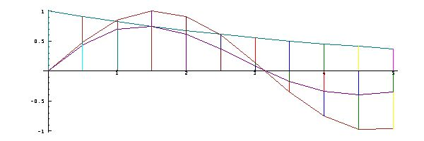

[17A. Introduction](#17a)

[17B. Designing an algorithm](#17b)

[17C. Explicit definition](#17c)

<span id="17a"></span>

## [17A. Introduction](#17-algorithms) [S17A.](supplement.html#s17a)

In cooking, a list of one or more instructions is called a *recipe*; in mathematics or computer science it is called a *program* or *algorithm*.

A recipe may call for some thing (such as Hollandaise sauce) which is itself specified by a recipe; in mathematics or programming such a thing is more commonly called a *function* or *component function*. For example, in the program

```
   odd=: 1:+even
      even=: 2:*i.
```

the program for the function `odd` makes use of the function `even`, and each function may be used independently:

```
   odd 5
1 3 5 7 9
   even 5
0 2 4 6 8
   (odd*even) 5
0 6 20 42 72
```

<span id="17b"></span>

## [17B. Designing an algorithm](#17-algorithms) [S17B.](supplement.html#s17b)

Except for the very simplest cases, it is best to begin by computing an example and assessing its suitability, and only then composing the required definition or definitions. We will illustrate two approaches to this final step:

Define component functions (such as `f` and `g`), and use them in a single definition (such as `h=: f+f on g`).

Use the *explicit* form of definition, in which the body of the definition is essentially a copy of the worked example, but with the arguments denoted by `x.` and `y.` .

**EXAMPLE 1** Define a function for the decaying sine curve.

We begin by assigning values to a list argument `x`, and applying sine and decay functions to it:

```
   x=: 1r2*i.11
   s=: 1&o. x
   ]n=: _1r5 * x
0 _1r10 _1r5 _3r10 _2r5 _1r2 _3r5 _7r10 _4r5 _9r10 _1
   d=: ^ n
   set 2
   d*s
0 0.43 0.69 0.74 0.61 0.36 0.077 _0.17 _0.34 _0.4 _0.35
   PLOT x;d,s,:d*s
```

 <span id="17c"></span>

## [17C. Explicit definition](#17-algorithms) [S17C.](supplement.html#s17c)

We will now illustrate the use of a form of definition in which the arguments occur explicitly (using the names `x.` and `y.`), and allows multiple lines in which names may be assigned to intermediate results. Thus:

```
   b=: 4 
   b
4
   
   f=: 4 : 0
a=: i. x.
b=: a ^ y.
c=: +/b
b;c
)
   
   5 f 2
+----------+--+
|0 1 4 9 16|30|
+----------+--+
   b
0 1 4 9 16
```

It is clear that the value originally assigned to `b` (in order to illustrate this matter) has been changed by the execution of `f`, behaviour that might cause the loss of valuable data. This unsuitable behaviour can be avoided by using a different copula (`=.`) to *localize* the names assigned within the function. Thus:

```
   f=: 4 : 0
a=.i. x.
b=.a ^ y.
c=.+/b
b;c
)
   
   7 f 3
+-------------------+---+
|0 1 8 27 64 125 216|441|
+-------------------+---+
   b
0 1 4 9 16
```

See Section S16C for a further example of explicit definition.

In Section 11E, the agenda operator `@.` was used to provide a *conditional* execution of functions in its argument. In many programming languages, conditional execution is provided by constructs such as *if*, *then*, *else*, and *while do*. The form used in explicit definition is illustrated by:

```
   SUM=: 3 : 0
i=.0
a=.0
while. i<y. 
   do. a=.next a
       i=.next i
end.
a
)
   
   SUM 4
6   
   0+1+2+3
6   
   sum=: +/ on i. 
   sum 4
6
```
