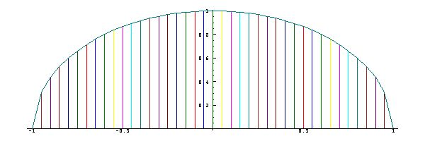

[18A. Introduction](#18a)

[18B. Area under a graph as a function](#18b)

[18C. Polynomial approximations](#18c)

<span id="18a"></span>

## [18A. Introduction](#18-anti-derivative-and-integral) [S18A.](supplement.html#s18a)

Just as the operator `d.1` can be applied to a function `f` to obtain its derivative, so the operator `d._1` can be applied to obtain its *anti-derivative*, that is, a function whose derivative is `f`. For example:

```
   derv=: d.1
   anti=: d._1
   
   c=: 1 2 3 4 5 6
   c with p.
1 2 3 4 5 6&p.
   c with p. derv
2 6 12 20 30&p.
   c with p. anti
0 1 1 1 1 1 1&p.
   c with p. anti derv
1 2 3 4 5 6&p.
```

**Exercises**

Experiment with the operators `derv` and `anti` on functions such as `^` and `1&o.` and `2&o.` and `6&o.`

Compare the derivatives of the functions `1 2 3 4 5&p.` and `7 2 3 4 5&p. `, and explain their agreement.

<span id="18b"></span>

## [18B. Area under a graph as a function](#18-anti-derivative-and-integral) [S18B.](supplement.html#s18b)

A study of the graph of Section 3B (an approximation to a circle) suggests that the area under the graph of a function `f` from the argument `_1` (or any fixed point) to an argument `x` is itself a function of `x` (that depends upon the function `f`).

We will first make a similar graph, using a finer grid (with a spacing 0.05 between points):

```
   a=:  i:1j40
   PLOT a;cir a
```

 What is the rate of change of the area function?

Consider the point `x=: 0.5`, the spacing `s=: 0.05`, and the next plotted point `x+s`. The change in area is due to the quadrilateral with base `s` and heights `cir x` and `cir x+s`, an area equal to `s` times the average of the heights `cir x` and `cir x+s`.

The rate of change `((cir x+s)-(cir x))%s` is therefore the average of `cir x` and `cir x+s`. For small values of `s`, this average approaches `cir x`; the derivative of the area under the graph of `cir` is therefore the function `cir` itself.

In other words, the area under the graph of a function is the anti-derivative of the function. Since this area can be viewed as the aggregation or *integration* of the component areas, it is also called the *integral* of the function.

<span id="18c"></span>

## [18C. Polynomial approximations](#18-anti-derivative-and-integral) [S18C.](supplement.html#s18c)

As illustrated in Section 3B, the area under a curve can be computed to give the value of the anti-derivative of a function at a chosen point. But this does not yield a *function* for the anti-derivative in the sense that the operator `d._1` does for the functions to which it applies.

This situation is analogous to the equation-solving of Chapter 9, which gives the inverse of a function for some chosen point, but not the inverse function itself.

A practical solution to the anti-derivative of a function `f` is provided by finding the coefficients of a polynomial that approximates it, and then using the fact that the anti-derivative (as well as the derivative) of a polynomial is easily obtained.

The expression `(f x) %. x^/i.n` yields the coefficients of an `n`-term polynomial that best fits the function `f` at the points `x`. For example:

```
   ]x=: i:1j10
_1 _0.8 _0.6 _0.4 _0.2 0 0.2 0.4 0.6 0.8 1

   ]c=: (1&o. x) %. x ^/i.5
_3.46945e_17 0.997542 9.99201e_16 _0.156378 _7.77156e_16

   c&p. _1 0 1
_0.841164 _3.46945e_17 0.841164

   1&o. _1 0 1
_0.841471 0 0.841471

   (c&p. x) ,. (sin x)
   _0.841164 _0.841471
   _0.717968 _0.717356
   _0.564748 _0.564642
   _0.389009 _0.389418
   _0.198257 _0.198669
_3.46945e_17         0
    0.198257  0.198669
    0.389009  0.389418
    0.564748  0.564642
    0.717968  0.717356
    0.841164  0.841471
```

The polynomial approximations may, however, be wildly wrong for arguments outside of the list `x` to which it was fitted.

The function `der` of Section 6B applied to a list of polynomial coefficients yields the coefficients of the derivative polynomial. A coresponding function for the anti-derivative may be defined as follows:

```
   der=: 1: |. ] * i. on #
   ant=: 0:,] % next i. on #
   ant c
0 1 1 1 1 1 1
   der ant c
1 2 3 4 5 6 0
```
