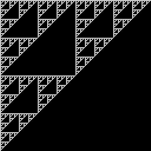

[20A. Introduction](#20a)

[20B. Mathematics: from the Birth of Numbers](#20b)

[20C. Concrete mathematics](#20c)

[20D. Computer Resources](#20d)

[20E. Conclusion](#20e)

<span id="20a"></span>

## [20A. Introduction](#20-further-topics) [S20A.](supplement.html#s20a)

In stating the purpose of this book in the preface we said:

> In the seventy-odd years since his publication, the development of computer programming has provided languages with grammars that are simpler and more tractable than that of conventional mathematical notation. Moreover, the general availability of the computer makes possible convenient and accurate experimentation with mathematical ideas....
>
> These facts make it possible to present to the layman a simple view of calculus as the study of the rate of change of a function, and to use it to provide insight into matters such as the sine and cosine functions (so useful in trigonometry and the study of mechanical and electrical vibrations), and into the exponential and its inverse the logarithm (so useful in growth processes and matters such as the familiar musical scale).

These matters have now been addressed, but there remain many practical and interesting topics (such as probability and statistics) that are well within the grasp and interest of a layman. Rather than pursue these, we will conclude by suggesting sources for further study.

Although there are many excellent elementary treatments of math (including some high-school texts), they are all couched in conventional notation, which we have (except for the discussion in Chapter 10) largely ignored. This may make their study difficult.

However, the use of a foreign (that is, unfamiliar) language also offers advantage: the effort of translation often forces one to "look behind the words" to gain a clearer understanding of their import.

We will discuss just two texts, in addition to resources available on the computer.

The first text (Gullberg, *Mathematics: From the Birth of Numbers* \[20\]) is serious, entertaining, and extensive, and provides a wealth of interesting historical detail. As stated in a foreword by Peter Hilton (an emeritus professor of mathematics):

> The unstated premise of this book - a premise that virtually all mathematicians would agree to - is that mathematics, like music, is worth doing for its own sake. The author is, by profession, a medical man, but he has a love for mathemtics and wants others to share his enthusiasm.
>
> This is not to deny the usefulness of mathematics; this very usefulness, however, tends to conceal and disguise the cultural aspect of mathematics.
>
> ...
>
> Further, the study of mathematics starts with the teaching of arithmetic, a horrible, wretched subject, far removed from real mathematics, but perceived to be useful. As a result, vast numbers of intelligent people become 'mathematics avoiders' even though they have never met mathematics. Their desire to avoid the tedium of elementary arithmetic, with its boring, unappetizing algorithms and pointless drill-calculations, is perfectly natural and healthy.
>
> To those intelligent people, it must seem absurd to liken mathematics to music as an art to be savored and enjoyed even in one's leisure time. Yet that is how it should appear and could appear if it were playing its proper role in our (otherwise) civilized society. Just as an appreciation of music is a hallmark of the educated person, so should be an appreciation of mathematics. The author of this book is a splendid example of an educated person bearing this hallmark.

The second (Graham, Knuth and Patashnik, *Concrete Mathematics* \[2\]) is presented as "A foundation for Computer Science". As stated in the preface:

> The course title "Concrete Mathematics" was originally intended as an antidote to "Abstract Mathematics", since concrete classical results were rapidly being swept out of the modern mathematical curriculum by a new wave of abstract ideas popularly called "The New Math." Abstract mathematics is a beautiful subject ... But its adherents had become deluded that the rest of mathematics was inferior and no longer worthy of attention.

This text is recommended not only because of its clarity and coverage, but also because of my *Concrete Math Companion* \[21\], which may prove helpful in the matter of notation. It provides an extensive commentary on the Graham text, expressed in the executable notation used here. <span id="20b"></span>

## [20B. Mathematics: from the Birth of Numbers](#20-further-topics) [S20B.](supplement.html#s20b)

We will comment on four topics covered by Gullberg, primarily to show the form of their expression in J, and the possibility for computer experimentation:

**CONTINUED FRACTIONS** On page 127, Gullberg says:

```
All real numbers can be written as periodic 
or nonperiodic, terminating or nonterminating, decimal
fractions. Another way of writing a rational number
is in the form of a continued fraction,
   N = a0 +            1
            -----------------------
            a1 +         1
                 ------------------
                 a2 +      1
                      -------------
                      a3 +    1
                           --------
                           a4 + ...
						   
or, in a kind of accepted mathematical "shorthand",

    N = [a0, a1, a2, a3 ...]
  
```

This is equivalent to the function `pr=: [+1:%]` applied over the list `a0,a1,a2,a3, etc.`, and Gullberg's example of 221/41 may be treated as follows:

```
   pr=: [+1:%]
   2 pr 5
2.2
   pr/5 2 1 1 3 2r1
221r41
   pr/5 2 1 1 3 2
5.39024
   pr/\5 2 1 1 3 2r1
5 11r2 16r3 27r5 97r18 221r41
```

The final expression illustrates how the operator `\` may be used to obtain the partial sums or "convergents" to the complete continued fraction.

The *fibonacci numbers* (treated by Gullberg on page 287) may also be obtained as continued fractions. For example:

```
   pr/\1 1 1 1 1 1 1 1 1 1r1
1 2 3r2 5r3 8r5 13r8 21r13 34r21 55r34 89r55
   pr/\1 1 1 1 1 1 1 1 1 1
1 2 1.5 1.66667 1.6 1.625 1.61538 1.61905 1.61765 1.61818
```

These decimal results may be recognized as increasingly good approximations to the Golden Mean (or golden number), also treated by Gullberg.

On page 143, Gullberg shows examples of continued fraction approximations to irrational numbers such as the square root of six:

```
   a=: 2 2 4 2 4 2 4 2 4
   b=: pr/a
   b
2.44949
   b*b
6
```

**DETERMINANTS** On pages 646,7, Gullberg states:

```
A determinant is a value
representing sums and products of a square matrix.

The determinant of a matrix A, det A, is denoted as
arrays of numbers or algebraic quantities, called 
entries or elements, disposed in horizontal rows and 
vertical columns enclosed between single vertical bars:

           | a11 a12 ... a1n |
   det A = | ... ... ... ... |
           | an1 an2 ... ann |
...
has 3! = 6 triple products of entries from every row
and column, of which no two triplets can be the same,


a11 a22 a33  a11 a23 a32  a12 a21 a33  a12 a23 a31  a13 a21 a32  a13 a22 a31
   1-2-3        1-3-2        2-1-3        2-3-1        3-1-2        3-2-1    
# of inversions:
    none         one          one          two          two         three
Correction factor:
     +1           -1           -1           +1           +1           -1
```

In J the determinant function is defined as `det=: -/ . *` which, applied to the three-by-three matrix (that is, table) of Gullberg's example yields the following results:

```
   det=: -/ . *
   A=:  2 3 4,.0 1 2,.4 0 2
   A
2 0 4
3 1 0
4 2 2
   det A
12
```

Gullberg notes the following properties:

> The value of a determinant is reversed in sign if any two rows are interchanged.
>
> Multiplying all entries of any row multiplies the determinant by the same factor.
>
> The area of a triangle is one-half the absolute value of the determinant of the matrix obtained by bordering the three-by-two table of its coordinates by a column of *ones*.

For example:

```
   (1 A. A);(det 1 A. A);(det A)
+-----+---+--+
|2 0 4|   |  |
|4 2 2|_12|12|
|3 1 0|   |  |
+-----+---+--+
   (1 3 1 * A);(det 1 3 1 * A);(3 * det A)
+-----+--+--+
|2 0 4|  |  |
|9 3 0|36|36|
|4 2 2|  |  |
+-----+--+--+
   (2 3 4 * A);(det 2 3 4 * A);((*/2 3 4)*det A)
+------+---+---+
| 4 0 8|   |   |
| 9 3 0|288|288|
|16 8 8|   |   |
+------+---+---+
   triangle=: 3 2$3 _2 , _4 1 , 8 3
   bt=: triangle,.1
   triangle;bt;(det bt);(1 A. bt);(det 1 A. bt)
+-----+-------+---+-------+--+
| 3 _2| 3 _2 1|   | 3 _2 1|  |
|_4  1|_4  1 1|_50| 8  3 1|50|
| 8  3| 8  3 1|   |_4  1 1|  |
+-----+-------+---+-------+--+
```

The last result agrees with Gullberg's statement that the *absolute value* of the determinant yields twice the area of the triangle. But, more generally, the determinant yields a *signed* area that indicates whether the vertices of the triangle (when plotted) occur in clockwise or counter-clockwise order.

Similarly, the tetrahedron specified by a four-by-three table of points in three dimensions may be bordered by ones and subjected to the determinant to yield six times (`!3`) its signed volume. For example:

```
   ]tet=: 4 3$0 0 0 , 1 0 0 , 0 1 0 , 0 0 1
0 0 0
1 0 0
0 1 0
0 0 1
   det tet,.1
_1
   ]tet2=: ?. 4 3$10
1 7 4
5 2 0
6 6 9
3 5 8
   det tet2,.1
_106
```

**LOGARITHMS** On page 154 Gullberg says:

> that is, a **logarithm** is an **exponent** which defines to what power the **base** *a* must be raised in order to give *x*, called the **anti-logarithm**.
>
> The following practicable systems of logarithms are used:
>
> lg *x* The **common** logarithm of *x* (to base 10) (also called log *x* ...)
>
> ln *x* The **natural** logarighm of *x* (to base e)
>
> lb *x* The **binary** logarithm of *x* (to base 2)
>
> log<sub>a</sub> *x* The logarithm of *x* to the base *a* (also called <sup>*a*</sup>log *x*, especially in older texts)

In J the function `a with ^.` gives the base `a` logarithm, and the function `^.` (or `1x1 with ^.`) gives the natural log. Hence:

```
   ln=: ^.
   log=: 10 with ^.
   lb=: 2 with ^.
   x=: 1 2 4 10 100
   ln x
0 0.693147 1.38629 2.30259 4.60517
   log x
0 0.30103 0.60206 1 2
   lb x
0 1 2 3.32193 6.64386
   ln -1 2 4 10
0j3.14159 0.693147j3.14159 1.38629j3.14159 2.30259j3.14159 
   ^ ln -x
_1 _2 _4 _10 _100
   log -x
0j1.36438 0.30103j1.36438 0.60206j1.36438 1j1.36438 2j1.36438
   10 ^ log -x
_1 _2 _4 _10 _100
```

**THE PEANO AXIOMS** On page 157 Gullberg says:

> The natural numbers were axiomatically defined in 1899 by **Giuseppe Peano** in his ... Later, Peano modified his axioms to include also zero:
>
> 1\. Zero is a number.
>
> 2\. Every natural number or zero, *a*, has an immediate successor *a* + 1.

The treatment in our Chapter 1 is based on Peano's original formulation (which did not include zero as a natural number), and denotes Peano's successor function by `>:` (and its inverse, the predecessor, by `<:`). <span id="20c"></span>

## [20C. Concrete Mathematics](#20-further-topics) [S20C.](supplement.html#s20c)

The text *Concrete Mathematics* \[2\] will be referred to as GKP, and will be discussed together with commentary on it (expressed in J) from *Concrete Math Companion* \[21\], to be referred to as CMC.

**GENERATING FUNCTIONS and TAYLOR SERIES** In Section 7.2 GKP states:

> Our generic generating function has the form
>
> G(z) = g<sub>0</sub> + g<sub>1</sub>z + g<sub>2</sub>z<sup>2</sup> + ... (7.12)
>
> and we say that G(z), or G for short, is the generating function for the sequence \<g<sub>0</sub>,g<sub>1</sub>,g<sub>2</sub>, ...\>, which we also call \<g<sub>n</sub>\>. The coefficient g<sub>n</sub> of z<sup>n</sup> in G(z) is sometimes denoted \[z<sup>n</sup>\]G(z).

In Section 7B, CMC discusses this as follows:

> In GKP7.12 the limit (as `n` approaches infinity) of the polynomial `G=. (g i.n) p. ]` is defined to be the *generating function* for the function `g`. In other words, `g k` is the `k`th element of the Taylor series for `g`.
>
> For example, the functions for the exponential, sine, and the product of the sine and the exponential may be generated as follows:
>
> ```
>       gex=. ^ t.
>      gsin=. 1&o. t.
>    gsinex=. (1&o. * ^) t.
>    ]ce=. gex i. 8
> 1 1 0.5 0.166667 0.0416667 0.00833333 0.00138889 0.000198413
>    ]cs=. gsin i.8
> 0 1 0 _0.166667 0 0.00833333 0 _0.000198413
>    ]cse=. gsinex i. 8
> 0 1 1 0.333333 0 _0.0333333 _0.0111111 _0.0015873
> ```

**SUBSCRIPTS VERSUS FUNCTIONS** In Section 2.1 GKP states that:

> We'll be working with sums of the general form
>
> a<sub>1</sub> + a<sub>2</sub> +...+ a<sub>n</sub>
>
> where each a<sub>k</sub> is a number that has been defined somehow.

In Section 2A, CMC discusses this as follows:

> We will therefore treat `a` as a function, and the list of indices as a second function, typically `i.` or the function `Ei=. i.@>: `. For example
>
> ```
>    Ei=. i.@>:
>    Ei 5
> 0 1 2 3 4 5
>    a=. *:
>    a Ei 5
> 0 1 4 9 16 25
>    +/ a Ei 5
> 55
> ```

**STIRLING NUMBERS** In Section 6.1, GKP defines Stirling Numbers of the first and second kind by:

> ...the number of ways to arrange n objects into k cycles
>
> ...the number of ways to partition a set of n things into k nonempty subsets

and provides tables of them in **Table 245** and **Table 244**.

In Section 5F, CMC introduces the falling factorial function `^!._1` and uses it to define the Stirling numbers as matrices that provide the coefficients for linear transformations between the coefficients of certain important polynomials.

The required transformation matrices are given by:

```
   s1=: |: on ((i. ^!._1/ i.) %. (i. ^/ i.))
   s2=: %. on s1
   (s1;s2) 8r1
+--------------------------------+-----------------------+
|1    0     0    0    0   0   0 0|1 0  0   0   0   0  0 0|
|0    1     0    0    0   0   0 0|0 1  0   0   0   0  0 0|
|0   _1     1    0    0   0   0 0|0 1  1   0   0   0  0 0|
|0    2    _3    1    0   0   0 0|0 1  3   1   0   0  0 0|
|0   _6    11   _6    1   0   0 0|0 1  7   6   1   0  0 0|
|0   24   _50   35  _10   1   0 0|0 1 15  25  10   1  0 0|
|0 _120   274 _225   85 _15   1 0|0 1 31  90  65  15  1 0|
|0  720 _1764 1624 _735 175 _21 1|0 1 63 301 350 140 21 1|
+--------------------------------+-----------------------+
```

Functions to provide Tables 245 and 244 of GkP are defined in terms of these as follows

```
   S1=: | on s1
   S2=: s2
   (S1;S2) 8r1
+----------------------------+-----------------------+
|1   0    0    0   0   0  0 0|1 0  0   0   0   0  0 0|
|0   1    0    0   0   0  0 0|0 1  0   0   0   0  0 0|
|0   1    1    0   0   0  0 0|0 1  1   0   0   0  0 0|
|0   2    3    1   0   0  0 0|0 1  3   1   0   0  0 0|
|0   6   11    6   1   0  0 0|0 1  7   6   1   0  0 0|
|0  24   50   35  10   1  0 0|0 1 15  25  10   1  0 0|
|0 120  274  225  85  15  1 0|0 1 31  90  65  15  1 0|
|0 720 1764 1624 735 175 21 1|0 1 63 301 350 140 21 1|
+----------------------------+-----------------------+
```

<span id="20d"></span>

## [20D. Computer Resources](#20-further-topics) [S20D.](supplement.html#s20d)

**LABORATORIES** Clicking the mouse on the menu item marked "Studio" shows a menu that allows the selection of either "Labs" or "Demos". Clicking on "Labs" provides an opportunity to choose a variety of topics.

These topics are presented as labs in the sense that, at any point in the presentation, you may enter your own J expressions to experiment with the ideas presented. Or you may use the facilities described in Section 4B to capture and revise expressions already used in the presentation or in your own experiments.

For example, choosing "Fractals, Visualization, & J" leads to a function which, applied repeatedly to the one-element list `,1`, produces a matrix with an interesting pattern. Moreover, it provides a function `viewmat` that plots a view of the matrix as a grid of black and white elements. Thus:

```
   f=: ,~ ,.~
   f ,1
1 1
1 0
   f f ,1
1 1 1 1
1 0 1 0
1 1 0 0
1 0 0 0
   f f f ,1
1 1 1 1 1 1 1 1
1 0 1 0 1 0 1 0
1 1 0 0 1 1 0 0
1 0 0 0 1 0 0 0
1 1 1 1 0 0 0 0
1 0 1 0 0 0 0 0
1 1 0 0 0 0 0 0
1 0 0 0 0 0 0 0

   load 'graph numeric trig'
   viewmat f f f f f f f f ,1
```



**DEMONSTRATIONS** The demos include a game (called Pousse), a table of distances between major cities, and numerous graphical displays of objects in two and three dimensions. By choosing the Definition option in some displays you may study, and even modify, the programs that produce them.

**DICTIONARY DEFINITIONS** Further information about J may be obtained from the Help menu as described in Section 4B, but definitions may also be obtained more directly by pressing key F1 to display the vocabulary, and then clicking on the desired item.

For example, selecting the item `o.` will show that the definition of the function `0 with o.` (used to graph circles in Sections 3B and 18B) is the square root of one minus the square.

A definition may also be displayed by placing the cursor immediately to the left of a symbol on the screen and pressing F1 while holding down the CONTROL key. <span id="20e"></span>

## [20E. Conclusion](#20-further-topics) [S20E.](supplement.html#s20e)

Study of this book will not make a mathematician, but we hope that the use of precise executable language possessing a simple strict grammar will further the cause stated by Hogben in our preface (and repeated here):

> The view which we shall explore is that mathematics is the language of size, shape and order and that it is an essential part of the equipment of an intelligent citizen to understand this language. If the rules of mathematics are the rules of grammar, there is no stupidity involved when we fail to see that a mathematical truth is obvious. The rules of ordinary grammar are not obvious. They have to be learned. They are not eternal truths. They are conveniences without whose aid truths about the sorts of things in the world cannot be communicated from one person to another.

Perhaps the most important lesson for the layman is that there is no need to be intimidated by mathematics or mathematicians. On this matter, we give the final word to Hogben:

> There is a story about Diderot, the Encyclopaedist and materialist, a foremost figure in the intellectual awakening which immediately preceded the French Revolution. Diderot was staying at the Russian court, where his elegant flippancy was entertaining the nobility. Diderot was informed that a mathematician had established a proof of the existence of God.
>
> .......
>
> Before the assembled court, Euler accosted him with the following pronouncement, which was uttered with due gravity:

```
         a+bn
       ------- = x, donc Dieu existe, repondez!
          n
```

Algebra was Arabic to Diderot. Unfortunately, he did not realize that was the trouble. Had he realized that algebra was just a language in which we describe the *sizes* of things, ... he would have asked Euler to translate ... into French.

.......

Like many of us, Diderot had stagefright when confronted with a sentence in size language. He left the court abruptly amid the titters of the assembly, confined himself to his chambers, demanded a safe conduct, and promptly returned to France.

## 
